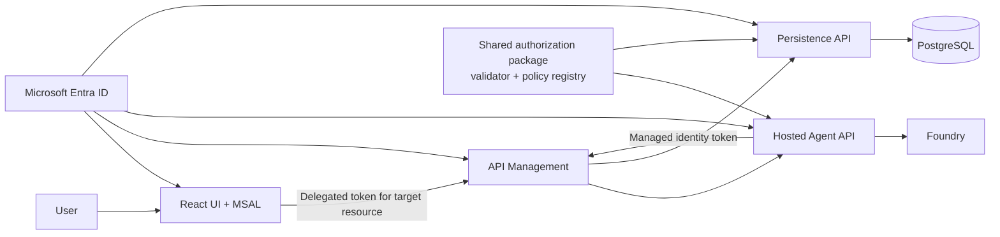

# Recommended Authentication and Authorization Design

## Design objective

Centralize authentication and authorization **policy definitions and
implementation**, while retaining authorization **enforcement at each service
boundary**. A gateway cannot replace resource-level authorization, and a
frontend cannot be a security boundary. The design should ensure that a
permission is defined once, mapped to one resource, and evaluated consistently
at every route that needs it.

## Target architecture



### Responsibilities

| Component | Responsibility |
| --- | --- |
| Microsoft Entra ID | Authenticate identities; issue signed access tokens and role claims. |
| React UI | Sign in with MSAL, request a token for the exact target API, and gate UI features for user experience. It does not make the security decision. |
| API Management | Require a bearer token, validate the issuer and audience, apply baseline throttling, and route traffic. |
| Shared authorization package | Own the common JWT validation code, policy names, claim parsing, error mapping, and tests. |
| Hosted Agent API | Enforce the policy for agent-invocation routes before processing input or running the model. |
| Persistence API | Enforce persistence-write and data-read policies before any database operation. |
| Managed identity | Authenticate the Hosted Agent when it calls the Persistence API; it receives only the persistence-write permission. |

## API registration and permission model

Use a distinct Entra resource application registration for each externally
reachable backend. Do not share one audience simply because both services are
part of the same solution.

| Resource API | Token audience | Delegated scope | App roles |
| --- | --- | --- |
| Hosted Agent API | `api://<hosted-agent-api-id>` | `Agent.Access` | `Agent.Invoke`, `Agent.Batch.Run` |
| Persistence API | `api://<persistence-api-id>` | `Persistence.Read` | `Persistence.Write`, `InteractionHistory.Read` |

The UI receives delegated permissions only for the APIs that it calls:

- Request `Agent.Access` only when invoking the Hosted Agent.
- Request `Persistence.Read` only when reading history or analytics.
- Do not grant the UI `Persistence.Write`.

Assign user/group roles to authorize browser users:

- `Agent.Invoke` permits direct invocation.
- `Agent.Batch.Run` permits batch invocation.
- `InteractionHistory.Read` permits history and analytics reads.

Assign `Persistence.Write` as an **application permission** only to the Hosted
Agent's managed identity. The Hosted Agent obtains a token for
`api://<persistence-api-id>/.default`; the Persistence API accepts that
application role for write routes.

## Central policy registry

Create one small, versioned package used by both Python backends. It should
contain:

- named policies, for example `AGENT_INVOKE`, `AGENT_BATCH_RUN`,
  `PERSISTENCE_WRITE`, and `INTERACTION_HISTORY_READ`;
- policy-to-resource audience mapping;
- accepted delegated scopes and app roles for each policy;
- strict JWT validation using the resource-specific tenant, issuer, audience,
  signing algorithms, and JWKS endpoint;
- optional caller client-ID allowlists;
- consistent `401` versus `403` errors and sanitized logging;
- unit tests for every policy.

Each route declares one named policy. Route handlers must not contain literal
role names, environment-variable lookups, or token claim parsing.

```python
@require_policy(AuthorizationPolicy.AGENT_INVOKE)
async def invoke_agent(...):
    ...

@require_policy(AuthorizationPolicy.PERSISTENCE_WRITE)
def persist_result(...):
    ...
```

The package centralizes the implementation; it does not centralize runtime
enforcement into a single service. Each service still rejects an invalid or
under-privileged request before executing business logic.

## Request flows

### User invokes the Hosted Agent

1. The UI signs in through MSAL and requests
   `api://<hosted-agent-api-id>/Agent.Access`.
2. The UI sends the access token to API Management and then the Hosted Agent.
3. API Management validates the token's tenant and Hosted Agent audience.
4. The Hosted Agent's shared authorization middleware validates the JWT and
   requires `Agent.Invoke` or `Agent.Batch.Run`, according to the route.
5. The Hosted Agent processes the authorized request.

### Hosted Agent persists a result

1. The Hosted Agent uses its managed identity to request
   `api://<persistence-api-id>/.default`.
2. API Management and the Persistence API validate the Persistence API
   audience.
3. The Persistence API's shared authorization middleware requires
   `Persistence.Write` in the token's `roles` claim.
4. Only then does the Persistence API write to PostgreSQL.

### User reads history or analytics

1. The UI requests `api://<persistence-api-id>/Persistence.Read`.
2. API Management and the Persistence API validate the Persistence API
   audience.
3. The Persistence API requires `InteractionHistory.Read`.
4. The API returns only data the policy permits.

## Configuration and operations

Keep resource IDs, tenant IDs, allowed client IDs, and role values in a single
reviewed configuration source. Environment variables should select deployment
values but not duplicate authorization decisions. Manage Entra app-role
definitions and assignments through reviewed IaC or deployment automation.

Use group-based user assignments, managed identities for workloads, short-lived
access tokens, HTTPS, and Application Insights logs that contain correlation
IDs and stable error codes but never tokens or complete claims. Enable
platform authentication at the gateway or service hosting layer as defense in
depth; preserve the application policy checks for route-specific authorization.

## Migration sequence

1. Define the two resource app registrations, scopes, and roles in Entra.
2. Introduce the shared authorization package and migrate existing token
   validation tests into it without changing route behavior.
3. Replace per-route role strings with named policies.
4. Configure API Management to validate the correct audience per route group.
5. Grant the Hosted Agent managed identity only `Persistence.Write`; remove
   broader write scopes and browser write permissions.
6. Add integration tests for valid and invalid tokens for every policy, then
   deploy with audit logging and monitor 401/403 rates.

